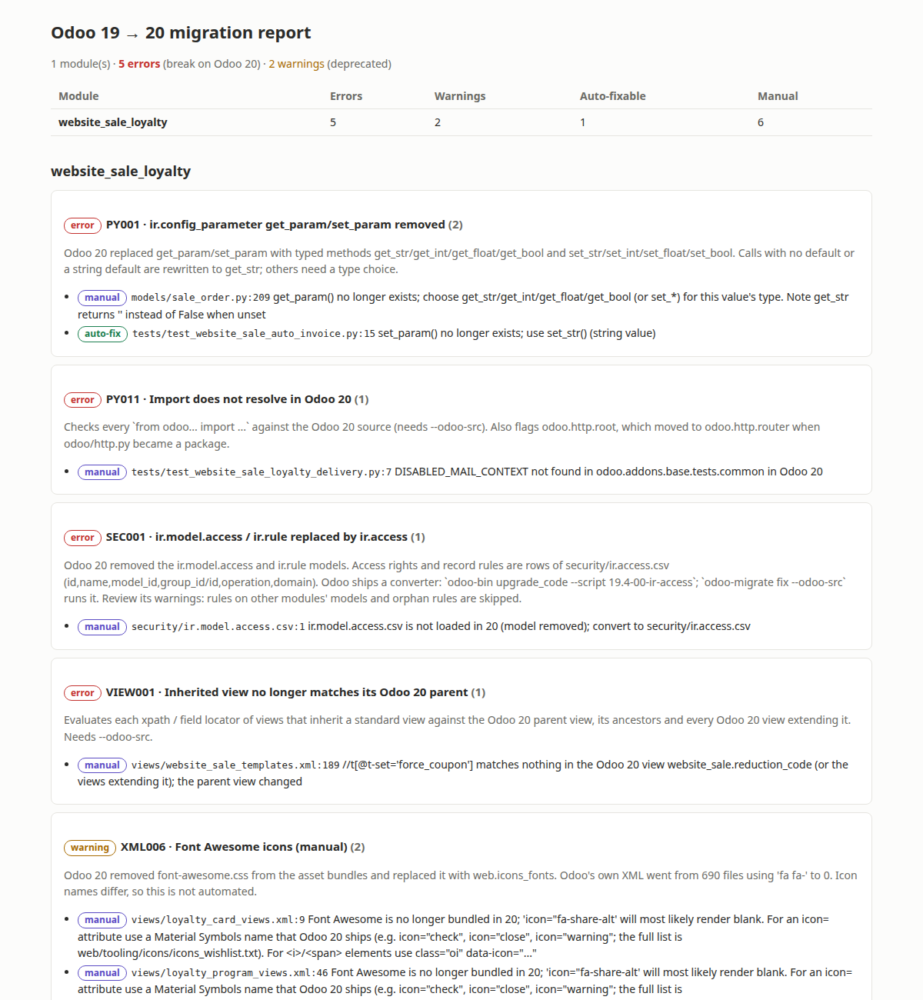
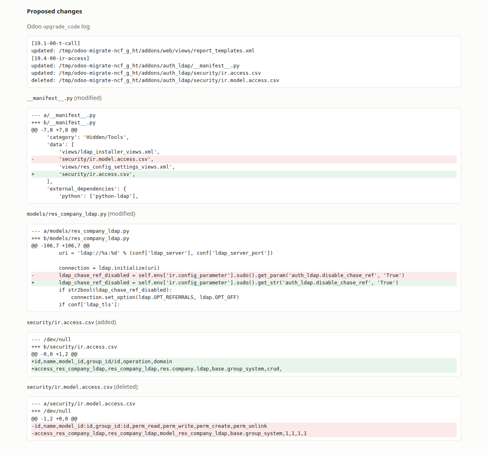

# odoo-migrate-20

A command-line assistant for moving custom Odoo modules from **Odoo 19 to Odoo 20**:
- It reports what will break, with the reason and the evidence in the Odoo source.
- It applies the fixes that are safe to automate, as a reviewable diff.
- It turns everything else into self-contained tasks for a developer (or an LLM).

```bash
odoo-migrate scan  ./my_module --odoo-src ~/src/odoo20          # report only, never changes files
odoo-migrate fix   ./my_module --odoo-src ~/src/odoo20          # dry run: shows the diff
odoo-migrate fix   ./my_module --odoo-src ~/src/odoo20 --write  # writes (Git must be clean, or a backup is made)
odoo-migrate tasks ./my_module --odoo-src ~/src/odoo20          # manual items as Markdown + JSON tasks
odoo-migrate rules                                              # list the rules
```



## Why another tool

- **OCA's `odoo-module-migrator`** (v0.5.0, checked 2026-10-14) supports target versions up to 18.0. It does not
  cover 19 → 20.
- **Odoo 20 ships its own rewrite scripts** (`odoo-bin upgrade_code`, in `odoo/upgrade_code/`). They convert
  access rights to the new `ir.access` format and a few other things. `odoo-migrate` runs them for you, safely
  isolated (see [Safety](#safety)), instead of re-implementing them.
- **Most breaking changes are not covered by those scripts.** Examples: `get_param` removed, QWeb `t-esc`
  removed, 999 fields and 79 models removed from standard modules, manifest versions, inherited views whose
  parent changed, and imports that moved. That is what this tool adds. The full list with evidence is in
  [docs/change-catalog.md](docs/change-catalog.md).

## Results

All measurements use Odoo's own Community modules: their 19.0 code is the input, and the 20.0 code that Odoo's
developers wrote is the ground truth. Sources: 19.0 commit `6394ce4b7`, 20.0 commit `73041605`.

### Detection: 583 modules that exist in both versions

For each change type, a module "needs" the change when its 19.0 code has the old pattern and Odoo's 20.0 version
no longer does.

| Change type | Rule | Modules needing it | Found | Recall | Precision |
|---|---|---|---|---|---|
| Access rights → `ir.access` | SEC001 | 206 | 206 | 100% | 100% |
| Font Awesome icons | XML006 | 168 | 168 | 100% | 100% |
| `get_param` / `set_param` | PY001 | 114 | 114 | 100% | 100% |
| QWeb `t-esc` | XML001 | 73 | 73 | 100% | 100% |
| `type="base64"` | XML004 | 61 | 61 | 100% | 100% |
| `report_file` field | XML007 | 35 | 35 | 100% | 100% |
| `odoo.tools` import moves | PY007 | 20 | 20 | 100% | 100% |
| Date filter attributes | XML003 | 2 | 2 | 100% | 100% |

**Removed fields** (no simple pattern, so measured differently): a finding counts as confirmed when Odoo's own
20.0 version of the same file uses that field name fewer times.

| Rule | Findings | Confirmed |
|---|---|---|
| FLD001, field used in a view | 702 | 99% |
| FLD002, field used in Python | 276 | 96% |

**How to read this honestly:** for the pattern rules, the ground truth is defined with the same patterns the rules
use. 100% shows that every file and every variant of the pattern is covered. It does not prove that the pattern
list is complete. Changes no rule knows about are, by construction, not in this table. The fix validation below
is the better test of completeness.

### Fix validation: does the module run on Odoo 20?

Nine small "leaf" modules (no other Odoo 20 module depends on them, and their dependencies did not change) were
installed on Odoo 20 and their own tests run, in three versions:

| Module | 19.0 code, unchanged | After `odoo-migrate fix` | Odoo's real 20.0 | Still reported as manual |
|---|---|---|---|---|
| data_recycle | install fails | **pass** (8 tests) | pass | — |
| auth_ldap | install fails | installs, 1 of 3 tests fails | pass | PY011 `odoo.http.root` |
| cloud_storage_migration | install fails | installs, 2 of 4 tests fail | pass | PY001 untyped `get_param` |
| pos_safaricom | install fails | install fails | pass | VIEW001, FLD001 |
| base_import_module | install fails | install fails | pass | PY011 |
| hr_recruitment_skills | install fails | install fails | pass | VIEW001, FLD001 |
| hr_holidays_attendance | install fails | install fails | pass | FLD001–003, VIEW001 |
| sale_pdf_quote_builder | install fails | install fails | pass | FLD002 (`ir.attachment.datas`), PY001 |
| website_sale_loyalty | install fails | install fails | pass | VIEW001, PY011, PY001 |

- **Automatic fixes alone:** 3 of 9 modules install, and 1 runs fully.
- **The rest:** for every module that still failed, the error that stopped it was reported by the tool as a
  manual item, in the right file. The tool knows what is left, but most real migrations still need a developer.
- **What changed during development:** the first validation run exposed four gaps:
  - inherited views pointing at elements that no longer exist
  - imports that no longer resolve
  - `odoo.http.root`
  - fields reached through `_inherits`

  Rules VIEW001 and PY011 and the `_inherits` support were added because of it.

Reproduce:

```bash
python scripts/evaluate_detection.py ~/src/odoo19 ~/src/odoo20 results/detection.json
python scripts/validate_fixes.py ~/src/odoo19 ~/src/odoo20 /tmp/work results/validation.json auth_ldap data_recycle ...
```

## Rules

| Rule | What | Fix |
|---|---|---|
| SEC001 | `ir.model.access.csv` / `ir.rule` → `ir.access` | Odoo's script |
| MAN001 | `19.0.x` version, `init_xml`/`demo_xml`, removed dependencies (`base_vat`, ...), removed asset bundles | auto (version, keys) |
| PY001 | `get_param`/`set_param` removed | auto when the type is clear |
| PY002 | `odoo.osv` removed | auto for AND/OR/TRUE/FALSE |
| PY003 | `read_group` signature, `toggle_active`, `suppress_traceback`, `_check_access` | manual |
| PY004 | `check_access_rights` & co. removed | auto |
| PY005 | `_check_recursion` → `not _has_cycle` | auto |
| PY006 | `api.deprecated` moved | auto |
| PY007 | `odoo.tools` imports moved or removed | auto for moved names |
| PY008 | `group_operator=` silently ignored | auto (`aggregator=`) |
| PY009 | `self._cr/_uid/_context` | auto |
| PY010 | strings naming removed models/fields (`res.bank`, `ir.rule`, ...) | manual |
| PY011 | `odoo...` imports that do not resolve in 20; `odoo.http.root` | manual |
| XML001–007 | `t-esc`, `t-raw`, date filters, `base64`, `date_delay`, Font Awesome, `report_file` | auto / Odoo script / manual |
| FLD001–003 | fields and models removed from standard modules (catalog of 999 fields, 79 models) | manual, with replacement hints |
| VIEW001 | inherited view xpath matches nothing in the Odoo 20 parent view | manual |

## Safety

- **`scan` never writes.**
- **`fix` previews by default.** It works on a temporary copy and shows a diff. With `--write`:
  - In Git, the module must have no uncommitted changes (or pass `--allow-dirty`, which also makes a backup).
  - Outside Git, a backup copy is made first.
- **Odoo's own scripts are isolated.** When started through `odoo-bin`, `upgrade_code` replaces the given addons
  path with Odoo's full addons path and rewrites **all** of Odoo's own addons. I learned this the hard way while
  testing: it modified 1,011 files of a real Odoo checkout. `odoo-migrate` therefore never runs it on your Odoo
  source. It does this:
  - copies the core framework and the module's dependencies into a throwaway directory
  - gives the process a throwaway home directory
  - compares the real checkout's `git status` before and after, and stops if anything changed
- **Unsafe rewrites are never applied automatically.** Examples: picking `get_int` versus `get_str`, renaming
  fields, rewriting `read_group`.

## What `fix` shows before writing anything

The dry run of `odoo-migrate fix auth_ldap --odoo-src … --format html`, combining Odoo's own `ir-access` converter
with this tool's `get_param` fix:



## Manual work as tasks (LLM-ready)

`odoo-migrate tasks` writes every manual finding as a task with:
- the problem
- the rule's background
- the surrounding code
- for broken inherited views, the actual Odoo 20 parent view

Each task includes a short instruction asking for the smallest diff that fixes it. The files can go to a developer
as they are, or into any LLM. The tool itself makes no network calls.

## Install and test

```bash
python -m venv .venv && . .venv/bin/activate
pip install -e ".[dev]"
pytest          # 29 tests: every rule has before/after cases
```

`fix --odoo-src` needs a Python that can run `odoo-bin` (`--python`, default `python3`). `scan --odoo-src` only
reads the source.

## Limitations

- **Scope:** Odoo 19 → 20 Community only. No Enterprise, no JavaScript/Owl, no database data migration.
- **Measured on Odoo's own modules, not on third-party custom modules.** Custom code may use patterns that no rule
  covers.
- **The removed-field catalog is built by static analysis:** fields declared with `fields.X(...)` and inheritance
  through `_inherit`/`_inherits`. Fields created dynamically are not seen. Rename hints are guesses (same type and
  a shared word).
- **VIEW001 does not apply views.** It checks each locator against the parent view, the parent's ancestors, and
  every Odoo 20 view extending it. It can miss problems that only appear once views are combined, and it can flag
  an element that another installed module would add.
- **Fix validation used 9 modules.** That is enough to find gaps, not to give a reliable success rate.
- **Developer time saved is not measured.**

## Adding a rule

See [docs/adding-rules.md](docs/adding-rules.md).

## License

MIT. See [LICENSE](LICENSE).
